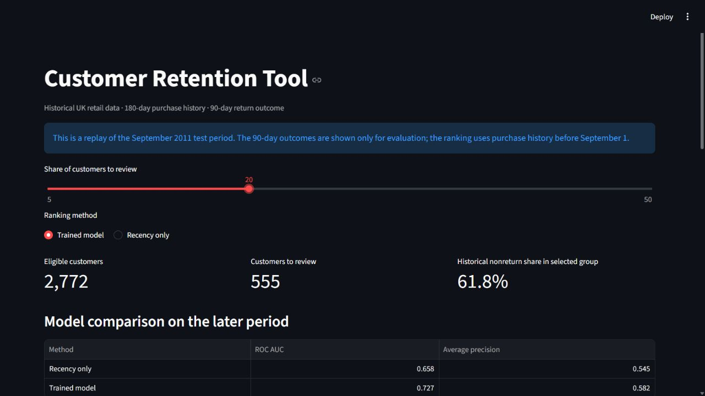
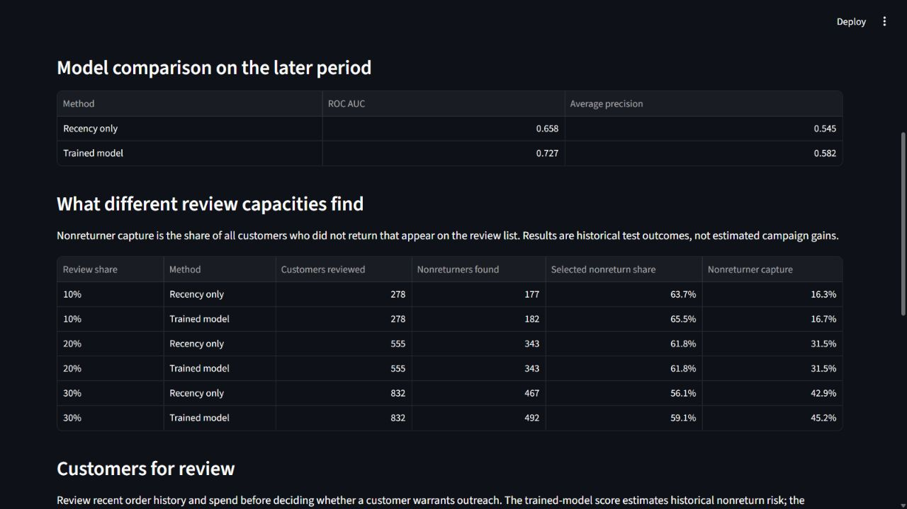

# Customer Retention Tool

An analysis of repeat purchasing using the [UCI Online Retail II dataset](https://archive.ics.uci.edu/dataset/502/online+retail+ii). The project asks: among customers who bought in the previous 180 days, which ones buy again in the next 90 days?

## Current work

The [data inspection notebook](notebook/01_data_inspection.ipynb) combines both years of transactions, documents purchase-cleaning rules, creates one row per invoice, and compares six historical customer cohorts. The [baseline notebook](notebook/02_customer_baseline.ipynb) builds customer features at each cutoff, evaluates a recency-only ranking, and compares it with a logistic regression model on the later September 2011 cohort. The [dashboard](app.py) replays that later cohort, compares rankings, and exports a review list. The shared [data preparation module](retention.py) applies the notebook's cleaning and cohort rules.

The cleaned data has 805,549 purchase line items, 36,969 orders, and 5,878 identified customers. At the June 1, 2011 cutoff, 1,331 of 2,659 eligible customers bought again within 90 days. These are descriptive results, not model performance or evidence that an outreach campaign would work.

On the September 2011 test cohort, 39.3% did not return within 90 days. Ranking by days since last order achieved ROC AUC 0.658 and average precision 0.545. A logistic regression model using recency, order count, spend, and average order value achieved ROC AUC 0.727 and average precision 0.582. In each method's highest-risk 20%, 61.8% did not return. The model improves overall ranking, but it does not improve this particular top-20% measure. These scores do not estimate outreach benefit. Some customers appear in both earlier and later snapshots; the test is a later time period, not a new-customer test.

## Findings for a review team

At a capacity of 10% of the September test cohort (278 customers), the model's list contained 182 customers who did not return, versus 177 using recency alone. At 20% (555 customers), both lists contained 343. At 30% (832 customers), the model's list contained 492 versus 467 using recency. These are retrospective selection counts; they do **not** estimate how many customers an outreach campaign would save. A team with capacity to review about 30% could examine the model's list first, but should test any outreach separately before claiming a retention gain.

The [data quality audit](docs/data_audit.md) found 26,124 exact duplicate valid purchase lines. Removing them lowers recorded revenue by 2.08% but leaves the later cohort's size, return rate, and rounded model ROC AUC unchanged. The largest 1% of orders account for 17.06% of revenue; excluding them changes eligibility slightly. Both choices are documented rather than silently applied.





## Run the project

1. Download `online_retail_II.xlsx` from the [UCI dataset page](https://archive.ics.uci.edu/dataset/502/online+retail+ii).
2. Place it at `data/raw/online_retail_II.xlsx`. This raw file is ignored by Git.
3. In a terminal at the repository root, create a Python environment and install the packages:

   ```powershell
   py -m venv .venv
   .\.venv\Scripts\python.exe -m pip install -r requirements.txt
   ```

4. Start the dashboard with `.\.venv\Scripts\python.exe -m streamlit run app.py`. The first load reads both Excel sheets and can take several minutes. Select the share of customers to review and a ranking method; use **Download review list** for the displayed customers.
5. To study the analysis, open either notebook in VS Code, select the `.venv` Python kernel, and run cells from top to bottom.

Run `python audit_data.py` for the data-quality sensitivity check and `python -m unittest discover -s tests` for the review-list calculation checks. Use the virtual environment's Python if it is not activated.

The dashboard is a historical replay using the September 1, 2011 cutoff. It does not fetch current customers or predict live outcomes. The review list contains customer IDs, purchase-history measures, and ranking scores; it omits the observed outcome column. Scores support prioritization, not automatic offers or claims of campaign impact.

## Data and limits

The dataset covers a UK retailer from December 2009 to December 2011. Rows without a customer ID cannot support customer-level retention analysis; cancellation invoices and nonpositive quantities or prices are excluded from valid purchases. Exact duplicate lines are kept because the dataset does not identify unique product lines and their validity cannot be settled from the available fields; the alternative is measured in the audit. The data includes no campaign assignments or outreach responses, so this project cannot measure the causal effect of contacting a customer.

Source: Chen, D. (2012). *Online Retail II*. UCI Machine Learning Repository. [DOI: 10.24432/C5CG6D](https://doi.org/10.24432/C5CG6D). Dataset licensed under CC BY 4.0.
